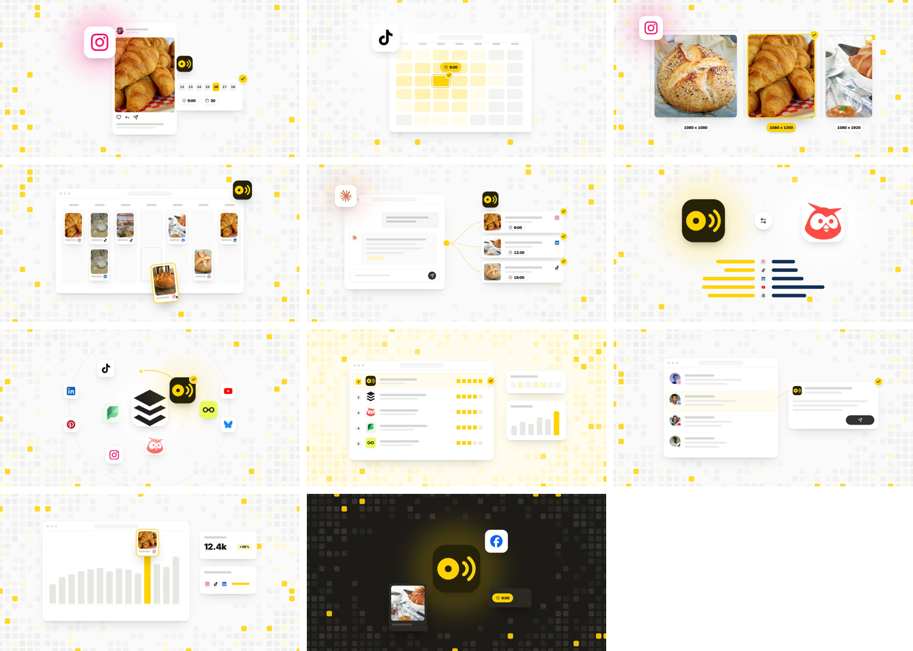

# Blog covers



Every Capybaroar blog post gets one cover. It is a picture in the app's calm style, built from fixed templates in `site/build/covers.mjs` and filled from a short spec in `site/build/covers.json`. Nobody draws a cover by hand, and nobody picks colors per post.

What we kept from the sister brands:

- **Omniscient** (`omniscient-site/tools/covers.mjs`): covers carry no words, since the title is already on the page. Each post type has its own scene. Real logos sit on raised white tiles. A signature background fills in toward the edges and leaves the middle clear. Random parts are seeded by the slug, so a cover stays the same until its spec changes.
- **Arrowsterr** (`src/lib/imageTemplates.ts`): the writer (or an agent) fills a small spec and the template does the drawing. Each template has limits, so a cover never comes out cramped.

## The rules

1. **Size.** 1200 × 630. The build writes `img/blog/<slug>.webp` at 2400 × 1260 for the post and the blog list, and `img/blog/<slug>.jpg` at 1200 × 630 for `og:image`.
2. **Safe zone.** Keep the main thing inside the middle 1040 × 560. X crops to 2:1 and blog cards crop to 16:9, and both cut the edges.
3. **No words.** Numbers are fine when they are the point: a time (`9:00`), a size (`1080 × 1350`), a result (`12.4k`, `+38%`). Text stands in as gray bars.
4. **The calendar field** is the background on every cover. Rounded day squares sit in weeks of seven, empty in the middle and filling in toward the edges, with a few booked in yellow. It comes in three tones:
   - `paper` (#FAFAFA) for most covers
   - `yolk` (#FFFCED) for lists and roundups
   - `night` (#1C1B17) for product news only
5. **Yellow is a fill with ink on it.** The check, the picked day, the best slot, the chosen size and the winning bar are yellow (#FFD202) with #262209 on top. Never use yellow text or yellow lines on white, except the dotted flow line (#E6BD00).
6. **One yellow hero per cover.** Exactly one thing is picked: one check, one day, one bar or one frame. Everything else stays gray and white.
7. **Logos, never names.** Networks and AI tools come from the homepage sprite. Other tools come from `site/build/cover-logos/<domain>.png` (square, 180px or larger). The Capybaroar mark is `icon.svg` on its dark tile.
8. **Real photos.** Posts show the bakery photos in `img/food` and the faces in `img/faces`. Never use stock people or drawn food.
9. **Raised things.** White cards at 12px, windows and phones at 16px or more, logo tiles at 24% of their size. Use ring shadows and never a dark frame.
10. **Glow** is only for the main logo, in that network's own color. Black logos get a soft white plate instead.

## The scenes

Pick the type that matches the post. Each one is listed with the fields it takes.

| Type | For posts like | Fields |
|---|---|---|
| `channel` | How to post on one network | `network`, `photo`, `face` |
| `time` | Best time to post | `network` |
| `size` | Image and video sizes | `network`, `formats` (2 to 3 `[w, h]`), `pick`, `photos` |
| `calendar` | Planning, content calendars, bulk scheduling | `networks` (up to 5) |
| `agent` | Posting from Claude, ChatGPT or Cursor, MCP, AI writing | `ai` (`claude`, `chatgpt`, `cursor`), `networks` (3) |
| `versus` | Capybaroar vs a tool | `vs` (domain) |
| `alternatives` | Alternatives to a tool | `subject` (domain), `others` (up to 4 domains) |
| `list` | Best tools roundups | `tools` (up to 5 domains) |
| `inbox` | Comments, DMs, community | `networks` (up to 4) |
| `analytics` | Reports, results, growth | `networks` (up to 3) |
| `news` | Product updates | `network` (optional), `photo` |

Networks: `instagram`, `facebook`, `tiktok`, `linkedin`, `youtube`, `x`, `threads`, `pinterest`, `bluesky`, `mastodon`, `discord`. Photos: `croissant`, `loaf`, `coffee`, `rack`, `shelf`, `shape`. Faces: `ana`, `dough`, `jon`, `leaf`, `maya`, `owner`, `rae`, `sam`, `tom`.

## Make a cover

1. Add the post to `site/build/covers.json`:
   ```json
   { "slug": "how-to-schedule-instagram-reels", "type": "channel", "network": "instagram", "photo": "croissant" }
   ```
2. For a tool that isn't on file yet, save its square logo as `site/build/cover-logos/<domain>.png` and add its color to `TOOL` in `covers.mjs`.
3. Run it:
   ```bash
   npm run site:covers
   ```
   or render one post with `node site/build/covers.mjs <slug>`.
4. Use `/img/blog/<slug>.webp` in the post and the blog list, and `https://capybaroar.com/img/blog/<slug>.jpg` as the post's `og:image`.

## Running cost

Covers render on a laptop or in CI with Chromium and sharp, which are already installed. They add $0 a month at Beta (50 teams) and $0 at Growth (500 teams). The images add about 100 KB per post on the site's own server.
